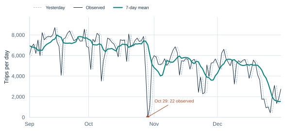

# Can we forecast tomorrow’s bike rentals?

A next-day forecasting case study for Capital Bikeshare. The decision is whether a simple estimate of system-wide trip volume is useful for staffing or capacity planning. This is a historical backtest, not a live forecast or station-level rebalancing tool.

**Result:** The **7-day rolling mean** won validation at **764.4 trips/day MAE**. On the final 120 days it missed by **977.8 trips/day**, versus **918.8** for repeating yesterday’s count. That makes its final-test MAE **6.4% higher**, not an improvement. Keep both as benchmarks and test on new periods before choosing a production method.

[Read the 5-page PDF](outputs/bikeshare-forecast.pdf) · [Interview notes](INTERVIEW.md) · [Result tables](outputs/)



## Data and forecast timing

The UCI Bike Sharing dataset (Hadi Fanaee-T, DOI `10.24432/C5W894`, CC BY 4.0) includes daily Capital Bikeshare rentals and weather.[1] This project uses `day.csv`: **731 consecutive dates**, January 1, 2011 to December 31, 2012, and **3,292,679** recorded trips. The loader verifies the downloaded file’s SHA-256, checks missing values and total count reconciliation, and the feature step checks for gaps and duplicate dates.

One row is one system-day. At the end of day `t-1`, predict total trips on day `t`. Ridge and the tree use rental lags of 1 and 7 days, the trailing 7-day mean, previous-day temperature and humidity, a known workday flag, and two features that let the calendar wrap smoothly from December to January. No target-day observed weather or same-day rental components are usable. The first seven dates supply lag history; 724 rows remain for scoring or training. Earlier observed holdout counts may feed later predictions: this simulates 120 nightly forecasts, not a 120-day-ahead forecast.

## Model comparison

The first 604 modeling dates form the development set. `TimeSeriesSplit` builds four expanding training windows, each followed by an 84-day validation block.[2] `MAE = mean(abs(actual - forecast))`. The selection rule chooses the simplest candidate within 2% of the lowest mean validation MAE. Simplicity order is the order shown below. The benchmark is the remaining simple rule with the lowest validation MAE. Fixed hyperparameters; no grid search.

| Candidate | Mean validation MAE, trips/day |
|---|---:|
| Yesterday’s count | 798.6 |
| Same weekday last week | 978.4 |
| **Mean of the last 7 completed days** | **764.4** |
| Ridge regression (`alpha=1`, training-only scaling) | 844.2 |
| Shallow tree (max depth 4, min leaf 15) | 1,053.4 |

The final test runs from **September 3 to December 31, 2012**. Neither choice is fit to the test period. Ridge did win two individual validation folds; the average did better overall and needs no training. The test reversal and a large miss on October 29 argue for fresh data and for testing predictors available *before* a sudden drop, such as forecast weather and preannounced outages. The study cannot infer the cause of that one day's low usage or tell how many trips went unserved.

## Reproduce it

Use Python **3.11** or **3.12**. Create a clean environment and run these commands from the project directory with that environment active:

```bash
python -m pip install -r requirements.txt
python -m unittest discover -s tests -v
python run.py
```

On first run the script needs access to UCI to download `day.csv`; a matching cached copy in `data/` works offline. The raw input is not committed. `forecast.py` implements the forecasting and split logic; `run.py` uses pandas, NumPy, scikit-learn, seaborn and Matplotlib to run it and rebuild the artifacts. `audit.sql` independently recomputes the two test MAEs in SQLite. `outputs/summary.json`, `validation_errors.csv`, `fold_schedule.csv` and `test_predictions.csv` hold the numbers behind the PDF. SVG versions of all six charts are in `outputs/figures/`.

AI assisted with the implementation and documentation. This is a personal portfolio case study, not work for or endorsed by Capital Bikeshare.

## Sources

[1] https://archive.ics.uci.edu/dataset/275/bike%2Bsharing%2Bdataset — Fanaee-T (2013), Bike Sharing dataset | UCI
[2] https://scikit-learn.org/stable/modules/generated/sklearn.model_selection.TimeSeriesSplit.html — scikit-learn: TimeSeriesSplit
